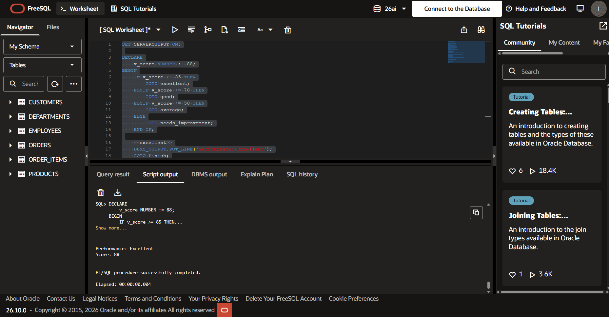
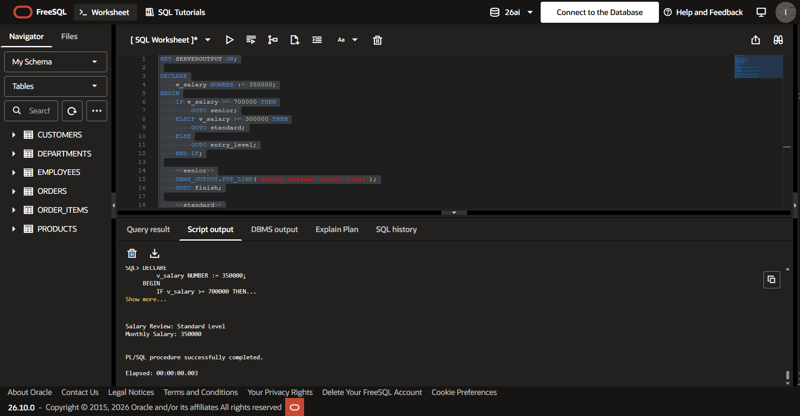
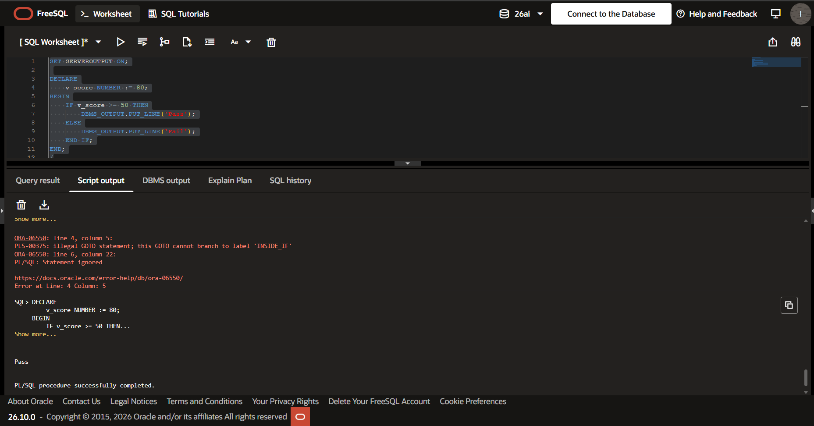
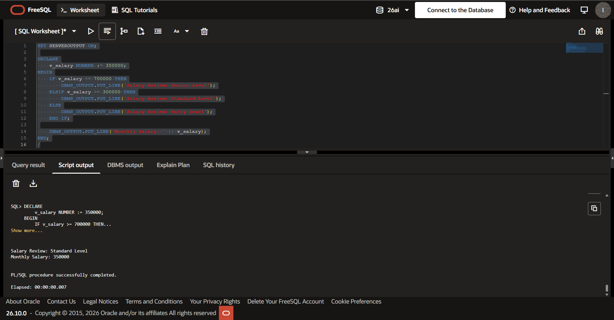
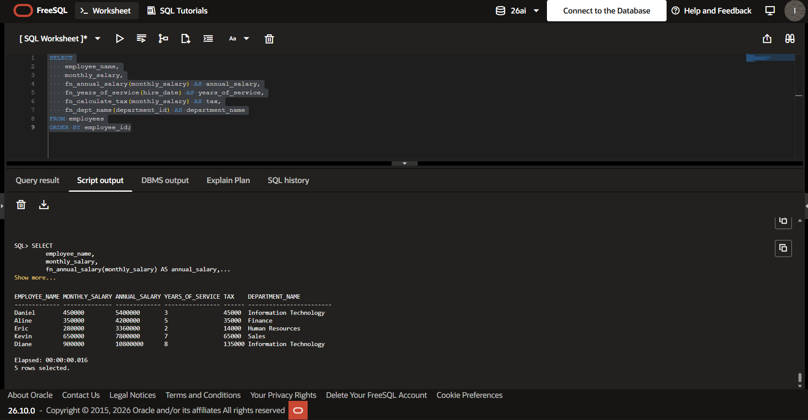
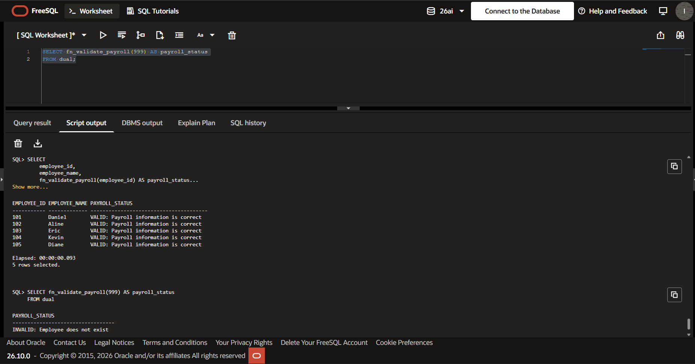

# PL/SQL GOTO Statements and Functions

An individual project on PL/SQL control flow and stored functions. It covers `GOTO` (including why it fails when used illegally), reusable functions, exception handling, and calling functions from inside SQL queries. Every example runs on an employee and payroll scenario.

| | |
|---|---|
| **Student** | Ishimwe Semuhungu Daniel |
| **Student ID** | 20251SEN037 |
| **Course** | Database Development with PL/SQL (INSY 8311) |
| **Environment** | Oracle PL/SQL on Oracle FreeSQL / Live SQL |

---

## What this project covers

**Part A: GOTO statements**

| Task | What it does |
|---|---|
| A1 | Classifies a number and a performance score using `GOTO` |
| A2 | Runs a salary review using `GOTO` |
| A3 | Shows an illegal `GOTO`, the error it raises, and the corrected version |
| A4 | Rewrites the A2 salary review without `GOTO` |

**Part B: Stored functions**

| Task | What it does |
|---|---|
| B1 | Calculates annual salary |
| B2 | Calculates years of service |
| B3 | Calculates tax |
| B4 | Returns a department name and handles the case where the department does not exist |
| B5 | Calls the functions above inside a SQL `SELECT` |

**Part C: Validation and reflection**

| Task | What it does |
|---|---|
| C1 | Payroll validation function |
| C2 | Written reflection, in [`docs/REFLECTION.md`](docs/REFLECTION.md) |

---

## How to run

Run the scripts in this order, since later files depend on earlier ones.

1. `00_setup/create_tables.sql` creates the tables and sample data.
2. `02_functions/` creates the stored functions.
3. `01_goto/` runs the `GOTO` programs.
4. `03_tests/` runs the test scripts.
5. Compare your output with the screenshots below.

---

## Output screenshots

### A1: Number classifier


### A2: Salary review


### A3: Illegal GOTO and the fix


### A4: Salary review without GOTO


### B5: Functions inside a SELECT query


### C1: Payroll validator


---

## Repository structure

```text
plsql-goto-functions-20251SEN037-Daniel/
├── README.md
├── .gitignore
├── 00_setup/        table creation and sample data
├── 01_goto/         Part A programs
├── 02_functions/    Part B and C1 functions
├── 03_tests/        test scripts
├── screenshots/     output evidence
└── docs/            reflection
```

---

## AI usage

I used an AI assistant for brainstorming how to organize the project, for explanations of a few PL/SQL concepts, and for troubleshooting. I wrote, ran, and tested the submitted code myself, and I can explain how each part works.

---

## Submission checklist

- [ ] Public GitHub repository with the correct name
- [ ] All required SQL files
- [ ] All six required screenshots
- [ ] README completed
- [ ] Reflection completed
- [ ] At least 5 meaningful commits
- [ ] GitHub link submitted through the Google Form
